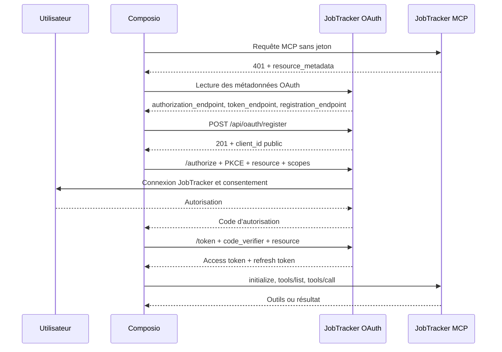

# Proposition : prise en charge du DCR pour Composio

- Statut : **implémentation initiale réalisée, validation Composio réelle en attente**
- Périmètre : serveur OAuth/MCP de JobTracker et intégration Custom MCP de Composio
- Date : 19 novembre 2026

## 1. Résumé de la décision proposée

Ajouter à JobTracker une prise en charge **limitée, révocable et désactivée par défaut** de
l'enregistrement dynamique de clients OAuth 2.0 (DCR, RFC 7591).

L'objectif initial est l'intégration de JobTracker comme **Custom MCP** dans Composio. Cette
intégration ne remplace ni les clients préenregistrés ni CIMD :

- clients préenregistrés : intégrations connues, avec relation préalable ;
- CIMD : clients MCP capables de publier leur identité ;
- DCR : compatibilité avec Composio et les clients qui ne savent utiliser que RFC 7591.

La première version doit accepter uniquement des **clients publics** :

- `token_endpoint_auth_method = "none"` ;
- code d'autorisation avec PKCE S256 obligatoire ;
- aucun `client_secret` émis ;
- aucune modification dynamique du client après l'inscription ;
- URI de retour HTTPS exactes et soumises à une politique d'hôtes autorisés ;
- scopes attribués par la politique JobTracker, jamais par confiance dans la demande.

Le DCR doit rester fermé tant qu'un administrateur ne l'a pas explicitement activé et configuré.

## 2. Constat actuel

JobTracker expose déjà :

- le MCP Streamable HTTP : `https://jobtracker.maadec.com/api/mcp` ;
- les métadonnées de ressource RFC 9728 ;
- les métadonnées du serveur d'autorisation RFC 8414 ;
- le flux Authorization Code + PKCE S256 ;
- le paramètre `resource` RFC 8707 ;
- des jetons opaques liés à la ressource, courts et révocables ;
- la rotation des refresh tokens ;
- des clients confidentiels, publics et CIMD ;
- un consentement explicite et des scopes granulaires ;
- un kill switch et des contrôles d'activation de production.

Il manque :

- `POST /api/oauth/register` ;
- `registration_endpoint` dans les métadonnées OAuth ;
- une politique administrative DCR ;
- les contrôles d'abus et le cycle de vie des clients DCR.

Composio Custom MCP accepte OAuth uniquement avec DCR. Les serveurs reposant uniquement sur un
client préenregistré ou CIMD ne sont pas compatibles avec cette fonctionnalité.

## 3. Objectifs et non-objectifs

### Objectifs

1. Permettre à Composio d'obtenir automatiquement un `client_id` public JobTracker.
2. Réutiliser sans affaiblissement le flux OAuth 2.1 existant.
3. Conserver l'isolation des données par utilisateur et par client.
4. Appliquer le principe du moindre privilège.
5. Limiter la création abusive de clients OAuth.
6. Permettre une désactivation et une révocation immédiates.
7. Ne jamais stocker de secret Composio dans le dépôt.

### Non-objectifs de la première version

- clients DCR confidentiels ;
- émission de `client_secret` ;
- `client_credentials` ;
- implicit flow ou password grant ;
- mise à jour ou suppression d'une inscription par le client ;
- `registration_access_token` ou `registration_client_uri` ;
- software statements, JWKS ou authentification JWT du client ;
- ouverture du DCR à tout domaine Internet ;
- modification du protocole MCP ou des schémas de ses outils.

## 4. Architecture cible

### 4.1 Point d'entrée

Ajouter :

```http
POST /api/oauth/register
Content-Type: application/json
Accept: application/json
```

L'endpoint doit répondre :

- `201 Created` avec les métadonnées effectivement enregistrées ;
- `400 invalid_client_metadata` pour des métadonnées non acceptables ;
- `429` pour une limite de débit atteinte ;
- `503` quand le DCR est désactivé mais que le MCP est disponible ;
- `503` quand le kill switch MCP est actif.

### 4.2 Découverte

Lorsque la politique DCR est opérationnelle, ajouter aux métadonnées :

```json
{
  "registration_endpoint": "https://jobtracker.maadec.com/api/oauth/register"
}
```

Ne pas annoncer `registration_endpoint` si :

- `MCP_ENABLED` est faux ;
- `MCP_PRODUCTION_ALLOWED` est faux en production ;
- le kill switch est actif ;
- la politique DCR est désactivée et le mode observation est inactif ;
- aucun hôte de retour n'est autorisé.

### 4.3 Demande minimale acceptée

Exemple indicatif ; la charge exacte envoyée par Composio doit être capturée en staging :

```json
{
  "client_name": "Composio",
  "redirect_uris": ["https://<callback-composio-confirmé>/..."],
  "token_endpoint_auth_method": "none",
  "grant_types": ["authorization_code", "refresh_token"],
  "response_types": ["code"]
}
```

Règles :

- `redirect_uris` : obligatoire, 1 à 10 valeurs uniques ;
- `client_name` : facultatif selon RFC 7591, validé s'il est présent ; valeur neutre sinon ;
- `token_endpoint_auth_method` : absent ou exactement `none` ;
- `grant_types` : `authorization_code` requis, `refresh_token` permis ;
- `response_types` : uniquement `code` ;
- `scope` : informatif seulement, réduit à la politique du serveur ;
- champs inconnus : ignorés conformément à RFC 7591 ;
- champs connus mais non pris en charge (`software_statement`, `jwks`, `jwks_uri`) : refusés par
  `invalid_client_metadata`.

### 4.4 Réponse

```json
{
  "client_id": "jt_oc_<valeur_aléatoire>",
  "client_id_issued_at": 1795096800,
  "client_name": "Composio",
  "redirect_uris": ["https://<callback-composio-confirmé>/..."],
  "token_endpoint_auth_method": "none",
  "grant_types": ["authorization_code", "refresh_token"],
  "response_types": ["code"],
  "scope": "watch:read applications:read interviews:read"
}
```

Aucun `client_secret`, `registration_access_token` ou `registration_client_uri` ne doit être
retourné dans la première version.

## 5. Politique de confiance

Créer une politique `oauth_dcr_policy` séparée de CIMD :

```json
{
  "enabled": false,
  "allowed_redirect_hosts": [],
  "default_scopes": [
    "watch:read",
    "applications:read",
    "interviews:read"
  ],
  "max_registrations_per_hour_per_source": 10,
  "pending_client_ttl_hours": 24
}
```

### Recommandation initiale

- déployer d'abord avec DCR désactivé ;
- activer le mode observation, qui annonce l'endpoint mais refuse toute inscription ;
- observer uniquement l'hôte de retour réellement présenté par Composio ;
- autoriser ensuite **l'hôte exact confirmé**, sans joker ;
- commencer en lecture seule ;
- ajouter les scopes d'écriture seulement après validation fonctionnelle et revue du consentement.

Ne pas inscrire dès maintenant `connect.composio.dev` ou `backend.composio.dev` par supposition :
l'hôte exact du callback doit être relevé dans une demande DCR réelle.

## 6. Modèle de données

Réutiliser `oauth_clients` avec les champs existants et les ajouts suivants :

```json
{
  "client_id": "jt_oc_...",
  "name": "Composio",
  "client_type": "public",
  "registration": "dcr",
  "redirect_uris": ["https://..."],
  "allowed_scopes": ["watch:read", "applications:read", "interviews:read"],
  "secret_hash": null,
  "active": true,
  "created_at": "...",
  "dcr": {
    "software_id": null,
    "redirect_hosts": ["..."],
    "request_fingerprint": "...",
    "first_grant_at": null
  },
  "expires_at": "..."
}
```

Cycle de vie :

1. Une inscription DCR sans consentement expire après 24 heures.
2. Lors du premier consentement approuvé, `expires_at` est supprimé et `first_grant_at` est fixé.
3. Un client désactivé reste enregistré pour audit et tous ses grants sont révoqués.
4. Une réduction des scopes par l'administrateur s'applique immédiatement.
5. Un élargissement ne modifie jamais un grant existant : nouveau consentement obligatoire.

Ajouter un index TTL partiel sur `expires_at` uniquement pour les clients DCR en attente.

## 7. Prévention des abus

L'ouverture d'un endpoint DCR augmente la surface d'attaque. Les protections minimales sont :

1. **Feature flag et politique en base**, tous deux fermés par défaut.
2. **Allowlist exacte des hôtes de redirection**, sans sous-domaines implicites ni jokers.
3. **HTTPS obligatoire**, port par défaut, sans identifiants, requête ou fragment.
4. **Clients publics seulement**, aucun secret généré.
5. **PKCE S256 obligatoire** au moment de l'autorisation.
6. **Corps JSON borné** à 16 Kio et `Content-Type` strict.
7. **Rate limiting en périphérie** et compteur persistant en base.
8. **Identifiant de source pseudonymisé** : HMAC de l'adresse IP avec un secret de service, jamais
   l'IP brute dans la collection de limitation.
9. **Expiration automatique** des inscriptions jamais consenties.
10. **Journalisation sans métadonnées sensibles** : résultat, hôte de retour, client_id tronqué ;
    jamais de code, jeton, cookie ou corps complet.
11. **Consentement obligatoire** : une inscription ne donne aucun accès en elle-même.
12. **Kill switch existant** applicable à l'inscription, l'autorisation, les jetons et le MCP.

Une simple limite en mémoire par instance Vercel n'est pas suffisante. Le contrôle principal doit
être persistant ou appliqué par l'infrastructure en amont.

## 8. Gestion des scopes

La demande DCR ne doit jamais décider seule des permissions. Les scopes effectifs du client sont
ceux de `oauth_dcr_policy.default_scopes`, dans l'ordre canonique de `SUPPORTED_SCOPES`.

Déploiement conseillé :

### Phase lecture seule

```text
watch:read
applications:read
interviews:read
```

### Phase écriture contrôlée

Ajouter individuellement après validation :

```text
opportunities:write
applications:write
interviews:write
```

La page de consentement doit continuer d'afficher chaque permission. Les outils d'écriture doivent
rester protégés par les contrôles MCP actuels et les validations métier existantes.

Attention : le challenge `WWW-Authenticate` actuel peut annoncer tous les scopes supportés. Il faut
vérifier le comportement de Composio et, si nécessaire, annoncer un socle minimal puis utiliser le
step-up OAuth sur `403 insufficient_scope`.

## 9. Flux Composio cible



## 10. Modifications de code proposées

### Backend

1. `backend/config.py`
   - limites et paramètres non secrets du DCR ;
   - aucune activation par défaut.

2. `backend/services/dcr_service.py` — nouveau
   - modèles de demande/réponse ;
   - validation RFC 7591 limitée au profil JobTracker ;
   - application de la politique ;
   - création du client public ;
   - limitation persistante et expiration.

3. `backend/services/oauth_service.py`
   - rendre `authorization_server_metadata` capable d'annoncer le DCR ;
   - marquer et gérer `registration="dcr"` ;
   - pérenniser le client au premier consentement ;
   - interdire aux routes manuelles de modifier les URI d'un client DCR.

4. `backend/routes/oauth.py`
   - ajouter `POST /register` ;
   - réutiliser `oauth_available` et les en-têtes `NO_STORE` ;
   - erreurs RFC 7591.

5. `backend/routes/admin.py`
   - lecture et mise à jour de la politique DCR ;
   - visibilité du type `dcr` et désactivation ;
   - aucune exposition du fingerprint ou des données de limitation.

6. `frontend/src/components/settings/OAuthConnectionsPanel.jsx`
   - interrupteur DCR séparé ;
   - hôtes exacts autorisés ;
   - scopes par défaut ;
   - avertissement explicite sur l'ouverture d'inscriptions distantes.

### Documentation

- remplacer « Pourquoi pas de DCR » dans `Doc/OAUTH.md` par la politique réellement implémentée ;
- ajouter le endpoint et les erreurs ;
- mettre à jour les guides Composio et l'exploitation ;
- documenter le rollback.

## 11. Tests obligatoires

Créer `backend/tests/test_p4_dcr.py`.

### Découverte

- endpoint absent quand DCR désactivé ;
- `registration_endpoint` absent quand la politique est désactivée et hors mode observation ;
- annoncé uniquement lorsque MCP, production, kill switch et politique le permettent.

### Validation

- JSON valide et `Content-Type` requis ;
- refus d'une URI non HTTPS, avec port, userinfo, requête, fragment, wildcard ou hôte non autorisé ;
- refus de `client_secret_*`, implicit, password et client credentials ;
- refus de metadata incohérentes ;
- déduplication des URI ;
- maximum de 10 URI ;
- champs inconnus ignorés ;
- aucun secret dans la réponse.

### Sécurité et cycle de vie

- client public uniquement ;
- PKCE S256 requis à `/authorize` ;
- correspondance exacte de `redirect_uri` ;
- scopes limités par la politique ;
- limite persistante et `429` ;
- expiration d'un client sans consentement ;
- conservation après premier grant ;
- désactivation : grants et tokens révoqués ;
- kill switch : inscription et usage bloqués ;
- aucun secret dans les logs.

### Bout en bout

- register → authorize → consent → token → `initialize` → `tools/list` → `jobtracker_ping` ;
- refresh token et rotation ;
- rejet d'un token pour une autre ressource ;
- 403 avec scope requis pour un outil d'écriture non accordé ;
- reconnexion après ajout d'un scope ;
- test contractuel avec une charge DCR Composio capturée en staging et anonymisée.

## 12. Déploiement progressif

### Étape 0 — Compatibilité contrôlée

1. Déployer derrière la politique DCR, désactivée par défaut.
2. Activer le mode observation sur le domaine public.
3. Créer un Custom MCP Composio de test.
4. Relever uniquement l'hôte de callback dans l'interface admin, sans secret ni URL complète.
5. Ajouter cet hôte à l'allowlist, désactiver l'observation et fixer le test contractuel.

### Étape 1 — Production en lecture seule

1. Déployer le code avec DCR désactivé.
2. Configurer l'hôte Composio exact et les scopes de lecture.
3. Activer la politique.
4. Créer le toolkit Composio.
5. Connecter un compte JobTracker de test.
6. Vérifier `tools/list` et les lectures.

### Étape 2 — Écriture

1. Revue des logs, quotas et consentements.
2. Autoriser un scope d'écriture à la fois.
3. Exiger un nouveau consentement.
4. Tester la création, la modification et la suppression avec confirmations utilisateur.

### Rollback

1. Désactiver `oauth_dcr_policy.enabled`.
2. Désactiver les clients DCR concernés pour révoquer leurs grants.
3. Déconnecter ou supprimer le Custom MCP dans Composio.
4. Garder CIMD et les clients préenregistrés inchangés.

## 13. Configuration Composio après implémentation

Exemple API v3.1, sans clé réelle dans le dépôt :

```bash
curl -X POST https://backend.composio.dev/api/v3.1/custom/toolkits \
  -H "x-api-key: $COMPOSIO_API_KEY" \
  -H "Content-Type: application/json" \
  -d '{
    "name": "JobTracker",
    "mcp_url": "https://jobtracker.maadec.com/api/mcp",
    "auth_schemes": [
      {
        "mode": "DCR_OAUTH",
        "discovery_url": "https://jobtracker.maadec.com/.well-known/oauth-authorization-server"
      }
    ],
    "user_id": "all"
  }'
```

`user_id: "all"` partage la définition du toolkit dans le projet Composio ; chaque utilisateur
doit toujours autoriser son propre compte JobTracker. Un toolkit privé exige actuellement un plan
Composio Pro.

L'API Platform Composio et le Connect MCP grand public sont des surfaces distinctes. La création du
Custom MCP doit se faire dans le projet Platform destiné à héberger le toolkit.

## 14. Critères d'acceptation

La fonctionnalité peut être considérée prête lorsque :

1. Composio crée le client sans intervention administrative JobTracker.
2. Aucun secret client n'est émis.
3. L'utilisateur voit JobTracker, l'hôte de retour et les scopes avant de consentir.
4. Les outils MCP sont synchronisés par Composio.
5. Les données d'un utilisateur ne sont jamais accessibles par un autre.
6. Les scopes d'écriture ne sont pas accordés par défaut.
7. La révocation JobTracker coupe immédiatement les appels Composio.
8. Le kill switch coupe inscription, OAuth et MCP.
9. Les inscriptions orphelines expirent automatiquement.
10. Les tests DCR, OAuth et MCP passent avec MongoDB réel.
11. Un essai de production contrôlé est documenté sans secret.

## 15. Risques résiduels

| Risque | Réduction proposée |
|---|---|
| Prolifération de clients | allowlist, rate limit persistant, TTL, monitoring |
| URI de retour malveillante | validation exacte et hôtes autorisés |
| Client au nom trompeur | nom normalisé + hôte de retour affiché au consentement |
| Scopes excessifs | politique serveur en lecture seule par défaut |
| Vol de jeton côté Composio | accès court, refresh rotatif, révocation et audience liée |
| Appels d'écriture non désirés | consentement, scope dédié, confirmations côté agent, idempotence |
| Dépendance à Composio | OAuth/MCP standard conservé ; CIMD et préenregistrement restent disponibles |

## 16. Sources

- [RFC 7591 — OAuth 2.0 Dynamic Client Registration](https://datatracker.ietf.org/doc/html/rfc7591)
- [MCP Authorization, révision 2025-11-25](https://modelcontextprotocol.io/specification/2025-11-25/basic/authorization)
- [Composio — Custom MCP](https://docs.composio.dev/docs/extending-sessions/custom-mcp)
- [RFC 8414 — Authorization Server Metadata](https://datatracker.ietf.org/doc/html/rfc8414)
- [RFC 8707 — Resource Indicators](https://datatracker.ietf.org/doc/html/rfc8707)
- [RFC 9728 — Protected Resource Metadata](https://datatracker.ietf.org/doc/html/rfc9728)
